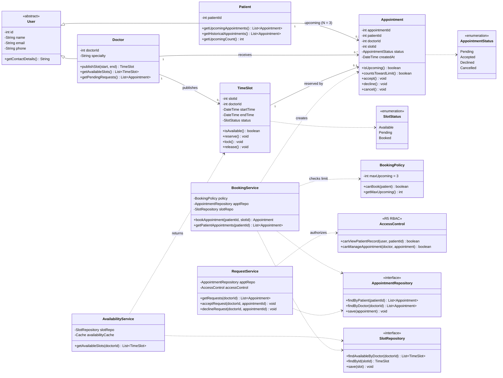

# Class Diagram: Doctor Appointment Booking System

Configuration: **N = 3** (max upcoming appointments per patient).
Upcoming = future `Pending` + `Accepted`. `Declined`, `Cancelled` and past appointments do not count.

## Traceability

| Requirement | Classes / Members |
|---|---|
| R1 View availability | `AvailabilityService.getAvailableSlots`, `TimeSlot`, `SlotStatus` |
| R2 Book appointment | `BookingService.bookAppointment`, `Appointment`, `TimeSlot.reserve` |
| R3 Accept / decline | `RequestService`, `Appointment.accept/decline`, `TimeSlot.lock/release` |
| R4 Max N = 3 upcoming | `BookingPolicy.canBook`, `Appointment.countsTowardLimit`, `Patient.getUpcomingCount` |
| R5 Authorized access | `AccessControl` (RBAC), used by `RequestService` |
| R6 Fast availability (< 2 s) | `AvailabilityService` cache, `SlotRepository` indexed by doctor and date |
| R7 Mobile usable | UI concern, not modeled as domain classes |

## Design Notes

- **Quota rule:** `Appointment.countsTowardLimit()` returns true only for `Pending`/`Accepted` appointments with a future time. `BookingPolicy.canBook` requires that count to be strictly less than 3.
- **Slot lifecycle:** `Available` → `Pending` on booking → `Booked` on accept (locked) → back to `Available` on decline.
- **Race condition (UC-2 4a):** `BookingService` re-checks slot availability atomically when creating the appointment.
- **Inheritance:** `Patient` and `Doctor` extend `User` for shared identity and contact details.