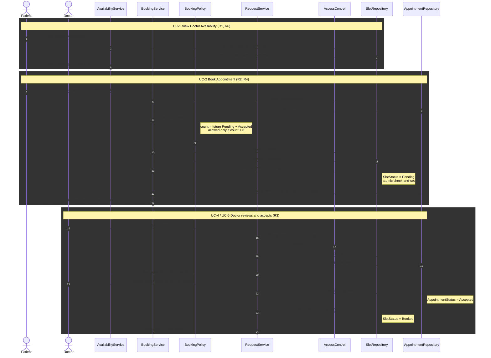
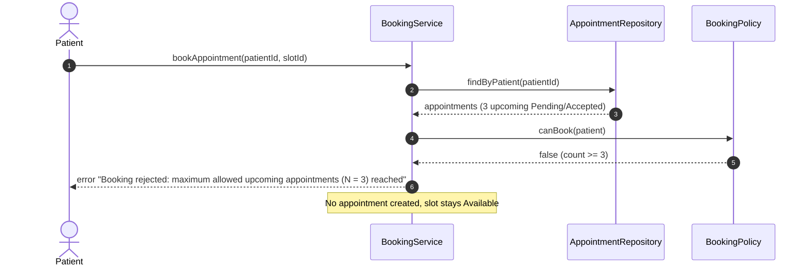
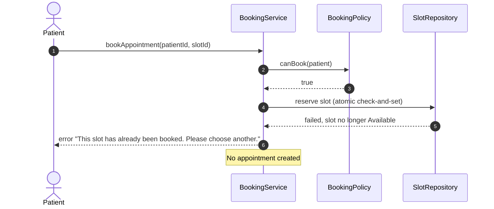
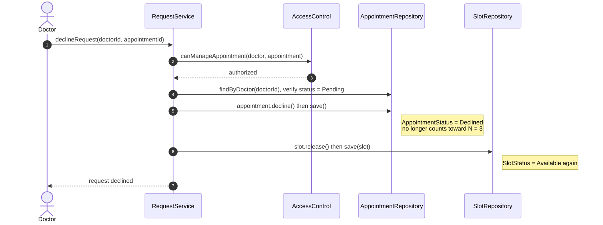

# Sequence Diagram: Appointment Request / Booking Interaction

Based on `class_diagram.md` (classes: `AvailabilityService`, `BookingService`, `BookingPolicy`, `RequestService`, `AccessControl`, repositories, `TimeSlot`, `Appointment`) and use cases UC-1, UC-2, UC-5 and UC-6. N = 3.

## 1. Main Flow: View Availability, Book, Doctor Accepts

## 2. Alternative Flows

### 2a. Upcoming Limit Exceeded (UC-2, alt flow 3a)

### 2b. Slot Already Taken: Race Condition (UC-2, alt flow 4a)

### 2c. Doctor Declines Request (UC-6)

## Notes

- **Quota check (R4):** `BookingService` loads the patient's appointments and `BookingPolicy.canBook` counts only future `Pending` and `Accepted` ones, matching `Appointment.countsTowardLimit()` in the class diagram. The check runs before any slot is touched, so a rejected booking leaves the slot `Available`.
- **Slot lifecycle:** `Available` → `Pending` (on booking) → `Booked` (on accept) or back to `Available` (on decline).
- **Race condition:** slot reservation is an atomic check-and-set in `SlotRepository`, so only one of two simultaneous bookings succeeds.
- **Authorization (R5):** `RequestService` calls `AccessControl` before returning requests or changing an appointment, so a doctor only sees and manages their own appointments.
- **Performance (R6):** `AvailabilityService` may serve slots from its cache; the repository query is indexed by doctor and date.