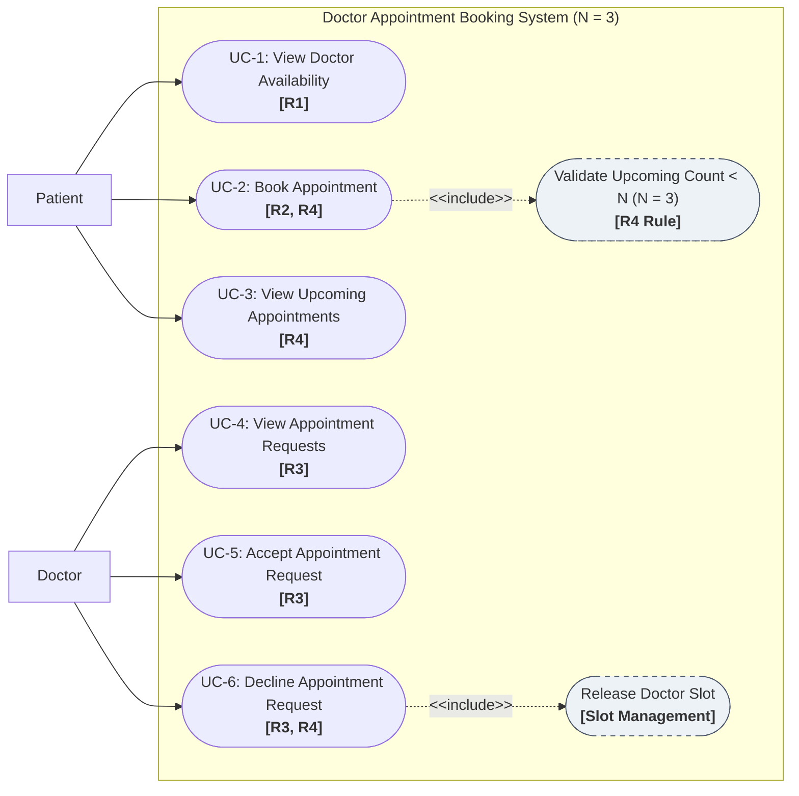

# Use Case Diagram

This diagram visualizes the primary actors and use cases for the **Doctor Appointment Booking System**, modeling functional requirements **R1–R4** with quota limit **N = 3**.

## Mermaid Diagram

---

## Diagram Elements Description

### 1. Actors
* **Patient**: Can inspect available doctor schedules, initiate booking requests, and monitor upcoming appointment quotas.
* **Doctor**: Can monitor incoming consultation requests and decide to accept or decline each request.

### 2. Core Use Cases & Requirements Mapping
* **UC-1: View Doctor Availability (R1)**: Patient views available dates and times for any doctor.
* **UC-2: Book Appointment (R2, R4)**: Patient reserves an available slot. System automatically includes a check to ensure the patient has fewer than N = 3 upcoming appointments.
* **UC-3: View Upcoming Appointments (R4)**: Patient views current active appointments (Pending + Accepted).
* **UC-4: View Appointment Requests (R3)**: Doctor views incoming appointment requests.
* **UC-5: Accept Appointment Request (R3)**: Doctor accepts a pending appointment.
* **UC-6: Decline Appointment Request (R3, R4)**: Doctor declines a pending appointment, which frees the time slot and removes it from the patient's upcoming quota.
